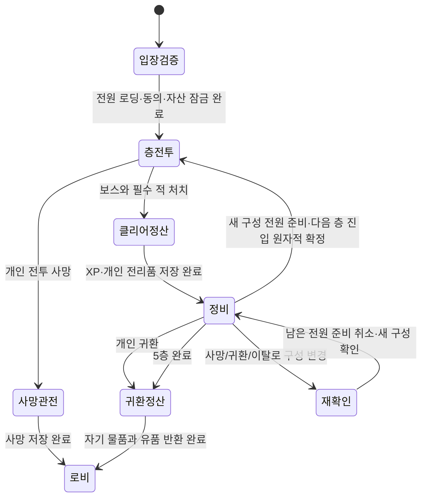

# 보스와 레이드 설계

2026-09-30. [상위 설계](../next-stage-design.md)의 추천 초안이다. 이름·패턴 수치·드랍 수량은 새 제안이며 플레이 검증 후 조정한다. 기존 강호/무공/사망/귀환 규칙을 대체하지 않는다.

## 공통 전투 원칙

보스는 평타 적의 HP만 높인 형태에서 벗어나 **접근 → 준비 → 공격 → 빈틈**을 반복한다. 공격 전에 안전한 위치와 방향을 읽을 수 있고, 공격 뒤에는 무공의 기본기를 넣을 시간이 있어야 한다.

- 이동만으로 기본 패턴을 피할 수 있다. 모든 빌드에 화산의 무적 회피가 있다고 가정하지 않는다. 무당 반격·삼재 경감·천마 회복도 별도 판정으로 검증한다.
- 피해 예고의 위치·폭·길이·범위는 실제 공격 정의에서 만든다. 그림 이펙트가 판정 경계보다 크게 번져 안전지대를 오해하게 하지 않는다.
- 조준은 준비 중 앞부분에서 추적하고, 공격 직전에는 방향을 고정한다. 방향 고정 시점도 표시한다. 공격 순간에 플레이어 위치로 다시 순간 조준하지 않는다.
- 갑작스러운 대량 잡몹·맵 전체 피해·필수 소모품·필수 특정 무공으로 실패를 만들지 않는다. 추가 적은 한 번에 적은 수로 제한하고 보스 전조와 구분한다.
- 페이즈 전환은 현재 예고한 공격을 먼저 끝낸 뒤 다음 패턴부터 적용한다. 체력 임계치를 여러 번 넘겨도 전환이 중복하지 않는다.
- 전환 연출은 짧게 하고 판정·입력을 임의로 늦추지 않는다. UI·카메라가 플레이어 위치를 가리지 않는다.

### 첫 조정값

| 항목 | 추천 시작값 | 검증 목적 |
| --- | --- | --- |
| 일반 강호 보스 전조 | 0.9~1.2초 | 현재 0.9초 기준에서 패턴을 충분히 읽는지 |
| 방향 고정 | 타격 0.3초 전 | 이동·회피·반격이 공정하게 가능할지 |
| 공격 후 빈틈 | 0.7~1.2초 | 기본기 A/B를 넣고 다시 이탈하는 리듬 |
| 기본 보스 패턴 | 2종 | 처음 보는 사람의 부담을 줄임 |
| 후반·레이드 패턴 | 3종, 동시 핵심 위협 최대 2개 | 복합 공략을 만들되 예고를 가리지 않음 |
| 보스전 소요 목표 | 강호 45~90초, 레이드 90~150초 | 체력만 늘어난 장기전 방지 |
| 전조 색/형태 | 위험은 붉은 경계+방향/해칭, 확정 대상은 작은 표식 | 색만으로 뜻을 전달하지 않음 |

전조를 짧게 만드는 것을 난이도 증가의 기본 수단으로 쓰지 않는다. 잡몹 수·패턴 조합·조준 대상 전환·안전한 공간 선택으로 먼저 조정한다.

## 강호의 네 보스

현 `chief`·`captain`은 초기 두 패턴의 기반으로 재사용한다. 5/10웨이브는 기존 계열을 다듬고, 15/20웨이브부터 실루엣과 전술을 구분한다. 아래 콘텐츠명은 가칭이다.

| 웨이브·지역 | 보스 | 핵심 패턴 | 배우는 행동 | 권장 상대 빌드 단계 |
| --- | --- | --- | --- | --- |
| 5·죽림 외곽 | 죽림 도적두목 | 넓은 횡베기 / 조준 돌진 | 옆으로 이동, 끝난 뒤 접근 | 처음 선택한 무공 1~3단계 |
| 10·낡은 산문 | 산문 궁수대장 | 부채꼴 3발 / 빈 방향이 있는 연속 발사 | 탄 사이 이동, 궁수와 거리 좁히기 | 두 번째 무공과 상황별 전환 |
| 15·고요한 고개 | 고개 철창객 | 긴 찌르기 / 2단 돌진 / 늦게 찍히는 표식 | 첫 회피 뒤 즉시 무리한 공격을 하지 않기 | 완성 무공 하나 또는 여러 기본기 |
| 20·강호의 문턱 | 흑풍 선봉장 | 베기→찌르기 조합 / 제한된 검기 / 짧은 증원 | 공격 끝·페이즈·무공 전환의 종합 판단 | Lv.13~16 목표의 최종 검증 |

보스 처치의 수련 비급 4개×20XP와 전체 강호 경험치 예산은 우선 유지한다. 새 보스나 추가 적 때문에 경험치가 무한 증가하지 않도록 구간 예산에서 나눈다.

### 죽림 도적두목

- 횡베기: 가까운 대상을 보고 넓은 부채 예고 → 방향 고정 → 한 번 베기 → 길게 회복.
- 돌진: 긴 직선 예고 → 목표 방향 고정 → 전진 → 끝에서 멈춤. 이동 경로도 피해 범위로 정의한다. 시작점·끝점의 그림만 찍고 중간 피해를 숨기지 않는다.
- HP 50% 이하에서는 두 패턴 순서를 바꾼다. 공격 횟수·체력 폭증은 하지 않는다.
- 첫 만남에는 첫 횡베기 전에 잠깐 접근 시간을 준다. 첫 화면 진입과 동시에 공격하지 않는다.

### 산문 궁수대장

- 부채 발사: 실제 3개 발사 방향을 가는 예고선으로 표시한다. 날아오는 탄의 크기는 hit radius와 함께 검수한다.
- 연속 발사: 표시된 한 대상의 옛 위치를 향해 순차 발사한다. 각 발사마다 목표가 갱신되는지는 패턴 정의에 고정한다.
- HP 50% 이하에서 소규모 궁수 2명 증원. 증원 위치를 미리 알리고 플레이어 바로 아래에 생성하지 않는다.
- 완전한 360도 동시 공격은 이 첫 원거리 보스의 기본 패턴으로 쓰지 않는다.

### 고개 철창객

- 긴 찌르기: 가늘고 긴 직선, 옆 공간을 충분히 남긴다.
- 2단 돌진: 두 번 각각 전조를 주고 첫 돌진 뒤 잠깐 쉬어 두 번째 방향을 읽게 한다. 예고하지 않은 즉시 후속타는 없다.
- 바닥 표식: 현재 위치에 작은 원을 남기고 일정 시간 후 찌르기. 원 가장자리와 피해 반경을 공유한다.
- HP 50% 이후 표식 다음에 돌진을 연결한다. 두 경고가 모두 활성 피해가 되는 순간은 만들지 않는다.

### 흑풍 선봉장

- 근접 연계: 횡베기 후 직선 찌르기. 첫 전조에서 연계 2타임을 표시하고 각 타격 시점을 구분한다.
- 검기: 열린 방향이 하나 이상인 부채꼴 5발. 좁은 틈을 픽셀 단위로 통과하도록 요구하지 않는다.
- 증원: 최대 3명의 일반 적, 한 번만. 현재 살아 있는 적 수를 포함해 제한한다.
- HP 60%/30%에서 패턴 조합만 강화한다. 기본 무공 전환과 선택한 빌드로 공략 가능해야 한다.

## 보스 데이터와 판정 구조

현재 `Enemy.pattern` 정수에 여러 보스의 조건문을 더하지 않는다. 보스 정의와 공격 정의를 분리한다.

| 정의 | 필수 내용 |
| --- | --- |
| `BossDefinition` | ID·표시 키·실루엣·기본 스탯·페이즈 임계치·패턴 가중치 |
| `AttackDefinition` | ID·준비/고정/접촉/회복 틱·모양·피해·넉백·방어 가능 여부 |
| `AttackInstance` | 실행 ID·시작 틱·고정 목표/방향·현재 단계·이미 맞은 대상 |
| `HazardDefinition` | 위험 영역·예고/활성/종료 틱·주기별 적중 제한 |
| `EncounterDefinition` | 보스·적·맵·스폰 위치·경험치/드랍 예산·스케일 프로필 |

전조, 서버 판정, 재현 기록은 같은 `AttackInstance`를 참조한다. 원·부채·직선·발사체의 순수 판정 함수는 `src/domain`에 두고 Phaser는 그림과 소리만 맡는다. 한 번의 베기가 같은 상대에게 프레임마다 중복 피해를 주지 않도록 attack ID별 적중 집합을 둔다.

무적·반격·방어 가능 여부는 실제 정의와 설명에 맞춘다. `Space`를 누른 그림만 보고 회피 성공으로 집계하지 않는다. 보스에게 무당 반격이 막히는 특수 규칙을 도입하면 도입 전 설명과 밸런스를 별도로 검토한다.

## 첫 레이드 — 흑풍산채 5층

하나의 테마를 완성하되 층별 공략이 다르게 느껴지게 한다. 방 전체가 보이는 현재 맵을 유지하고 이동 중 길 찾기·카메라 추적·복잡한 공대 역할은 첫 범위에 넣지 않는다.

| 층 | 전투 구성 | 공략 변화 | 보상 방향 |
| --- | --- | --- | --- |
| 1 외곽 경계 | 기존 검·창 적과 강화 도적두목 | 안전한 공격 끝에 접근 | 회복 보급·기초 장비·캐릭터 XP |
| 2 훈련 마당 | 궁수대장과 적은 호위 | 표식 대상과 다른 파티원이 공간 나누기 | 품질 범위 개선·캐릭터 XP |
| 3 병기고 | 새 보스 `철갑 호위장` | 방패의 앞/옆을 보고 움직이기 | 도포·검·수련 비급 후보 |
| 4 내원 | 철창객과 좁은 시간차 표식 | 대상별 표식을 겹치지 않게 이동 | 상위 품질 장비 확률 개선 |
| 5 산채 본당 | 새 보스 `흑풍채주` | 회전 베기·검기·두 대상 표식의 조합 | 테마 장비·높은 XP·수련품 후보 |

철갑 호위장은 정면 피해를 일부 줄이되 완전 면역으로 오래 버티지 않는다. 혼자서도 옆으로 이동해 공격할 수 있다. 흑풍채주는 한 명에게만 공격이 몰리지 않게 대상을 바꾸지만 힐러·탱커·정해진 무공을 요구하지 않는다.

### 파티 스케일 추천

다음 층 진입 직전에 남은 생존 참가자의 수 N을 확정한다. 해당 층 시작 후 죽거나 연결이 끊겨도 중간에 보스 HP와 난이도를 다시 줄이지 않는다.

- 시작 HP 배수 후보: `1 + 0.65 × (N − 1)` → 1인 1.0 / 2인 1.65 / 3인 2.30 / 4인 2.95.
- 공격 피해는 인원만으로 증가시키지 않는다. 패턴의 표식 수·소규모 적 수를 조절한다.
- 1인은 표식 1개, 2인은 최대 2개, 3~4인은 최대 2개부터 검증한다. 안전한 공간이 전원에게 있어야 한다.
- 목표 선택은 생존·활성 캐릭터에 대해 수행한다. 공격 준비가 시작된 뒤 다른 아군에게 조준이 갑자기 옮겨가지 않는다.
- 아군 캐릭터는 서로 길을 막거나 탄을 막지 않는다. 아군 공격 피해·보스 반사로 인한 아군 피해는 없다.

소수 인원 출전의 보상을 감산하거나 마지막 타격·DPS로 드랍 소유자를 정하지 않는다. 개인별 보상표를 서버에서 생성한다. 전투 참여가 없는 캐릭터의 자동 보상 방지는 피해량만으로 결정하지 않고 공격·방어·이동·접속 상태를 함께 검토한다.

## 레이드 성장과 층 사이

추천안: 처치 XP는 개인별로 기록하고 레벨업/무공 선택은 층 클리어 정비 때 확정·제공한다. 전투 도중 다른 사람을 멈추거나 선택 창으로 캐릭터를 방치하지 않는다. 죽은 무인을 XP로 부활시키지 않는다.

- 각자가 언제든 준비를 취소하고 정리하거나 귀환할 수 있다. 모든 준비는 현재 `partyRevision`에 연결한다.
- 한 명이 빠지면 남은 사람의 준비를 모두 풀고 `3명 → 2명`을 알린다. 남은 사람에게 귀환과 다시 준비하기를 함께 제공한다.
- 다음 층 시작 요청과 귀환 요청이 겹치면 서버에서 먼저 확정된 파티 버전으로 판정한다. 출발 카운트다운만으로 귀환을 막지 않는다.
- 정비판 물품·미처리 성장·수명 부족·저장/연결 오류가 있으면 준비할 수 없고 사유를 표시한다.
- 이미 완료된 층으로 재접속해도 XP·전리품이 다시 생성되지 않는다. 사용하지 않은 성장 후보도 그대로 복구한다.
- 5층 종료 후 남은 물품의 수납/포기와 귀환을 처리한다. 넘치는 물품을 임의로 창고에 넣지 않는다.

## 유품과 악의적 파티 플레이

사망 즉시 무인은 `dead`로 확정한다. `weapon/general/equipped` 물품만 현장 유품으로 옮기며 창고·시장 에스크로 물품은 제외한다.

첫 구현의 회수는 층 클리어 후 정비에서 허용하는 추천안이다. 전투 중에는 시체/원 소유자 표식만 확인하고 가방을 읽기 전용으로 유지한다. 전투 도중 월드에서 빠르게 회수하는 별도 행동은 이후 설계하며 가방 안 자유 정리를 우회하는 기능으로 넣지 않는다.

| 상태 | 처리 추천안 |
| --- | --- |
| 아군이 회수 | 기존 크기의 칸을 사용, 원 소유 세가 표시, 사용·장비 연결·판매 불가 |
| 운반자가 생환 | 원 소유 세가의 창고/수령 대기로 자동 반환, 실제 무인은 사망 유지 |
| 운반자도 사망 | 같은 원 소유권으로 현장에 재드랍, 다른 생존자가 회수 가능 |
| 회수자가 필요 없어 내려놓음 | 정비에서 같은 레이드 현장에 내려놓기, 보관권만 반환 |
| 정리판에서 폐기/일반 이동 | 금지, 원 소유권을 없애는 행동을 제공하지 않음 |
| 회수 못한 유품·파티 전멸 | 해당 레이드 종료 때 손실로 정산, 자동 원 소유자 반환은 하지 않음 |
| 접속 해제 | 원 소유권 유지, 즉시 무료 귀환·창고 반환 없음 |

유품은 일반 아이템의 복제본이 아니라 같은 item ID와 원 소유권을 가진 운반 상태다. 잠금 표시를 드랍/가방/정보/정산까지 일관되게 사용한다. 로비까지 반입해 계속 맡아두는 방식은 첫 범위에서 제외하고 생환 시 자동 반환한다.

소유권 보호는 아군 죽음을 통한 약탈 이익을 제거하지만 보스 유도·고의 미참여까지 완전히 없애지는 못한다. 전투 중 강제 추방은 제공하지 않는다. 정비에서 본인이 안전 귀환할 수 있게 하고, 파티 이력·차단·신고에 쓸 사건 기록을 남긴다. 구조한 유품 수는 기록하되 유품 한 개마다 재화 보상을 주는 파밍 경로는 만들지 않는다.

## 이 문서의 완료 검사

1. 네 강호 보스를 네 무공의 방어 행동과 이동만으로 각각 공략하고, 예고·실제 공격 범위의 일치를 캡처한다.
2. 보스 HP 임계치 점프·동시 공격·중복 타격·맵 경계 돌진·투사체의 빈 틈을 규칙 검사로 확인한다.
3. 1/2/3/4인의 스케일과 각자 다른 표식, 두 명 동시 사망·운반자 재사망·서버 정산 재시도를 확인한다.
4. 귀환 한 명 발생→남은 사람 준비 해제→다른 사람 귀환/잔류→새 난이도로 출발을 실제 브라우저 여러 개로 조작한다.
5. 정비 성장·수납·약 사용·연결 변경·정리판 폐기 확인·유품 내려놓기·귀환이 1093×614에서도 가려지지 않는지 검사한다.
6. 현재는 이 검사 항목의 설계만 완료했다. 신규 보스를 플레이 검증한 상태는 아니다.
