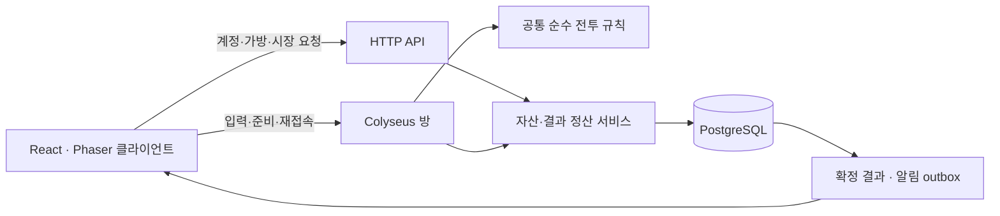

# 온라인·성장·자산·복구 설계

2026-09-30. [상위 설계](../next-stage-design.md)의 구현 구조 추천안이다. 다음 개발을 준비하는 문서이며 계정·서버·DB를 설치하거나 현재 브라우저 자산을 이전한 상태는 아니다.

## 시스템 구조

React·Phaser·TypeScript 화면과 순수 전투 규칙을 유지한다. 첫 온라인 서버 후보는 Node.js·TypeScript·Colyseus, 영속 상태는 PostgreSQL이다. HTTP API와 실시간 방을 같은 서버 프로젝트에서 시작하고, 실행 프로세스는 방 상태와 DB의 소유권을 구분한다.

Colyseus는 권위 있는 게임 방·상태 동기화·매칭을 제공하므로 도입 후보로 선정했다. 그 위에서 이 게임의 자산 원장·정산·수명·권한 규칙을 직접 구현해야 한다. [공식 개요](https://docs.colyseus.io/)를 확인했으며 정확한 패키지 버전과 기존 Node·Phaser 프로젝트의 호환성은 별도 작은 연결 실험 뒤 lockfile로 고정한다.

Redis는 첫 단일 서버에 필수로 넣지 않는다. 여러 방 프로세스·공유 큐·분산 presence가 필요해질 때 도입한다. DB의 소유권·사망을 Redis 캐시만으로 확정하지 않는다. Phaser와 DOM은 서버에 가져오지 않는다.

### 코드 분리 제안

| 현재/예정 위치 | 책임 |
| --- | --- |
| `src/domain/*` → 향후 `packages/game-rules/*` | 전투 계산·공격 모양·무공·수납·성장 후보·명시적 난수/시계 |
| 향후 `packages/contracts/*` | 요청/응답 스키마·모드·오류 코드·네트워크 버전 |
| `src/game/*` | 렌더링·로컬 예측·보간·서버 확정 효과 |
| `src/platform/store.ts` | 기존 로컬 어댑터 유지, UI와 모드 상태 연결 |
| 향후 `src/platform/online/*` | 로그인 세션·room 연결·서버 스냅샷·행동 요청 |
| 향후 `server/rooms/*` | 강호 1인·레이드 1~4인·비무/생사결 2인 방 |
| 향후 `server/services/*` | 출전 잠금·성장·사망·유품·추출·시즌·시장 |
| 향후 `server/db/*` | 마이그레이션·트랜잭션·제약·백업/복구 |

전체 파일을 한 번에 이동하지 않는다. 현재 로컬 동작을 공통 규칙 어댑터로 검증한 뒤 분리한다. `Date.now()`·`Math.random()` 기본 인자는 온라인 경로에서 사용하지 않고 서버가 제공한 시각과 seed를 명시한다. 브라우저와 서버의 계산 재현은 같은 규칙 버전·입력 순서·시드·고정 timestep으로 검사한다.

## 전투와 영속 무인의 분리

| 개념 | 내용 |
| --- | --- |
| `FighterRecord` | 무인 ID·세가·레벨/XP·보유 무공·수명·상태·실제 HP·빌드 버전 |
| `ActorState` | 방 안 위치/방향·팀·HP·행동·공격 순서·쿨타임·게이지 |
| `LoadoutSnapshot` | 출전 시 검/연결/착용품/무공/스탯·규칙 버전의 검증 사본 |
| `WorldState` | 여러 actor·적·공격·투사체·위험 구역·틱·모드 상태 |
| `ModePolicy` | 일시 정지·가방 행동·성장 시점·HP 반영·사망·보상 규칙 |

`Run.fighter`를 둘로 복제해 서로 다른 두 런을 돌리지 않는다. 같은 세계와 틱에 두 전투 주체가 있어야 충돌·반격·동시 사망이 일관된다. `Projectile.friendly`는 owner actor와 team·대상 필터로 확장하고 레이드 아군 피해 없음과 PVP 상대 피해를 같은 판정에서 구분한다.

무인 하나는 `available / reserved / in-session / defeated-pending / dead / expired` 중 하나의 영속 상태다. 시장에 걸린 아이템, 유품 운반품, 다른 방에 잠긴 무인은 새 출전에 사용할 수 없다. 방의 로컬 인원과 DB 잠금의 세션 ID·epoch가 맞아야 행동을 받는다.

PVP의 한 틱은 입력/방어 상태 적용 → 접촉 대상 수집 → 방어·반격과 피해 산출 → 대상별 피해 합산 → 살아남은 대상의 적중 회복 → 종료 판정 순으로 설계한다. 한 캐릭터의 죽음을 먼저 처리해 같은 틱의 상대 타격을 없애는 배열 순서 의존을 제거한다. 치명 피해를 이미 받은 actor가 적중 회복으로 되살아나지 않게 한다. 방어의 다중 공격 소비·궁극 무적·반격 반사도 고유 공격 ID와 명시한 순서로 검증한다.

## 계정과 로컬 저장

온라인 세가 ID는 인증된 계정의 서버 ID에 묶는다. 추천 로그인은 검증된 인증 제공자의 Google 로그인과 이메일 복구다. 구체적인 제공자·비용·발송 인프라는 실제 운영 환경 선택 때 확정한다. 클라이언트가 전송한 세가 ID만으로 다른 창고·무인을 읽거나 수정하지 않는다.

- 현재 IndexedDB 저장은 로컬 플레이 전용으로 유지한다. 로그인 실패·로그아웃·서버 장애가 로컬 저장 삭제를 유발하지 않는다.
- 온라인과 로컬은 표시와 저장 공간을 구분한다. 모드 변경으로 진행 중인 로컬 강호를 온라인 새 강호로 덮어쓰지 않는다.
- 온라인 무인은 서버 판정의 온라인 강호 20웨이브로 생성한다. 온라인 비무·레이드에 클라이언트가 만든 로컬 무인/아이템을 업로드하지 않는다.
- 인증 방식만 바꿔 세가를 새로 만들지 않도록 계정 연결·복구를 설계한다. 계정 병합과 자산 병합은 첫 버전에서 자동 제공하지 않는다.
- 저장 스키마에는 `schemaVersion`, `rulesVersion`, `revision`, `commitId`를 둔다. 읽기·검증·변환·검증 후 같은 커밋의 안전 사본을 보존한다. 검증 실패 시 원본을 보존하고 오류를 알린다.

## 서버가 받아들이는 입력

실시간 입력은 `sessionId, epoch, sequence, estimatedServerTick, movement, aim, actionEdges, activeArtRequest`다. aim은 월드 좌표/각도로 정규화한다. 클라이언트 시각은 참고값일 뿐 피해·수명·성장·소유권의 기준이 아니다.

| 요청 | 서버 확인 |
| --- | --- |
| 이동/공격/방어/QE | 연결·epoch·seq·현재 상태·해금·쿨타임·입력 유효 범위 |
| 아이템 이동/사용/연결 | 소유권·위치·세션 잠금·비전투 여부·공간·빌드 revision |
| 성장 선택 | 계정·무인·저장된 후보 ID·미사용 성장 기회·phase |
| 준비/귀환 | 현재 floor·partyRevision·성장/정리판/자료/수명 조건 |
| 자비/결착 | 승자·defeated 상태·결정 마감·미정산 match ID |
| 매물/구매 | item definition·소유권·잔고·에스크로·listing revision |

클라이언트가 damage·승리·XP·가격 합계·품질에 따른 실제 능력치를 결정하지 않는다. 재화는 정수 단위, 요청 개수·크기·빈도와 숫자 범위를 검증한다. 아이템 스탯은 서버의 정의·품질·규칙 버전에서 계산한다.

### 통신 조정값

- 기존과 같은 60Hz 고정 계산으로 시작해 30Hz와 비교한다. 서버의 실제 처리 시간과 전투 감각을 측정한 뒤 결정한다.
- 이동 입력 30Hz, 버튼 edge 즉시·다음 입력에 중복 포함, state patch 20Hz를 시작값으로 둔다. 버튼 이벤트는 고유 seq로 한 번만 소비한다.
- 내 이동과 공격 준비는 즉시 예측하고 미승인 입력을 보정한다. 다른 대상은 보간하며 피해/아이템/사망은 예측으로 영속 상태에 쓰지 않는다.
- 공격 예고는 공격 ID·시작/고정/접촉/종료 서버 틱을 전달한다. 이펙트 프레임 전체를 DB나 네트워크에 저장하지 않는다.
- 반격·회피의 지연 보정은 별도 검증한다. 첫 비공개 연결 단계는 서버 틱 판정으로 검증하고, 공개 PVP 전에 최대 100ms 과거 위치 검토 같은 제한된 정책을 시험한다. 내 방어와 상대 공격이 서로 다른 과거를 참조해 이미 맞은 피해를 임의로 취소하지 않게 한다.
- 200ms 입력 공백 뒤에는 마지막 이동·공격을 계속 유지하지 않는다. 재접속 뒤 옛 epoch의 입력을 버린다.
- 메시지 큐는 유한하게 하고 늦어진 위치 스냅샷은 최신 상태로 합친다. 중요 결과는 seq와 재조회로 복구한다. `WebSocket` 자체에는 backpressure가 없으므로 앱이 수신/발신량을 제한해야 한다. [MDN](https://developer.mozilla.org/en-US/docs/Web/API/WebSocket).

공개 PVP 완료 조건은 RTT 30/80/150ms, jitter 30ms·패킷 손실/재연결을 주입한 양쪽 화면에서 입력·예고·반격·결과가 합리적으로 일치하는 것이다. 임의의 지연 보정 수치만으로 공정성을 선언하지 않는다.

## 영속 데이터와 불변식

| 테이블/집합 | 핵심 필드·제약 |
| --- | --- |
| accounts / families | 인증 subject·세가 ID·상태·온라인 설정 |
| fighters / fighter_arts | 소유 세가·상태·HP·XP·수명·spent·build revision·무공별 상한 |
| item_instances / item_locations | 고유 item ID·definition·원 소유자·위치·운반자·회전·좌표·revision |
| wallets / wallet_entries | 정수 잔고·거래 event ID·출처/목적, 음수 불가 |
| sessions / participants | mode·rulesVersion·phase·room epoch·출전 잠금·빌드 사본 |
| floor_rewards / growth_offers | 층·계정별 한 번·seed·경험치·후보·선택 결과 |
| corpse_cargo / extraction_receipts | 원 소유자·현장/운반자·반환/손실 결과 |
| match_results / stakes / rankings | 확정 결과·판돈·순위 변화·시즌·한 번 지급 키 |
| listings / market_orders / fills | 매물·잔여량·가격·에스크로·체결·수수료 |
| room_checkpoints / outcome_events / outbox | 동일 커밋·틱·해시·정산 이벤트·미전달 알림 |

필수 불변식:

1. 아이템 하나는 항상 정확히 한 위치에 있으며 운반권과 소유권을 구분한다. 무기 링크는 유효한 무장 가방의 검만 참조한다.
2. 출전·시장·이동 잠금은 서로 배타적이다. 소유자와 revision이 맞지 않으면 요청을 거부한다.
3. 죽은/만료된 무인은 공격·수련·재출전하지 않는다. 재접속으로 상태를 생존으로 바꾸지 않는다.
4. 같은 XP·판돈·유품 반환·시즌 보상·체결은 고유 결과 키로 한 번만 반영한다.
5. 자산 정산 성공과 그 알림은 같은 DB 커밋에 연결한다. 알림 전달 실패로 결과를 다시 지급하지 않는다.
6. 개인 보상은 외부 계정에 공개하지 않는다. 파티 HUD는 아군 HP·접속·선택 무공 등 협동에 필요한 상태만 공개한다.

트랜잭션에서는 무인·아이템·지갑 행을 일관된 ID 순서로 잠그고 제약을 검사한다. 필요한 다중 행 작업은 row locking 또는 SERIALIZABLE과 제한된 재시도를 사용한다. 고유 제약·idempotency 키와 함께 구현해야 중복을 막는다. PostgreSQL의 잠금과 deadlock 처리는 [공식 문서](https://www.postgresql.org/docs/current/explicit-locking.html)에서 확인했다.

## 주요 정산의 한 번 처리

### 출전

인증 → 무인 생존·HP·수명·성장 완료·정리판 비움 확인 → 장비/무인 잠금 → 빌드 사본과 세션 생성 → 양쪽/파티 로딩 준비 → 시작 커밋. 시작 실패는 전투 전 취소로만 잠금·판돈을 되돌린다. 룸 생성 실패가 캐릭터 사망이나 아이템 삭제가 되지 않는다.

### 레이드 사망

방이 치명타 판정 → 같은 결과 키로 무인 `dead`, 아이템 현장 유품, 사망 기록·방 체크포인트 저장 → 저장 성공 후 사망 확정 표시. 물품 이동 요청과 동시 사망은 같은 방 이벤트 순서에서 직렬화한다. 저장 실패 중에는 해당 방 진행을 멈추고 결과 확정을 재시도한다. 다른 방을 전부 멈출 필요는 없다.

### 유품 회수와 귀환

현장 item 행 잠금 → 현재 위치 확인 → 운반자 공간 검증 → 원 소유자 유지·운반 위치 변경. 생환 시 자기 물품을 귀환 상태로 옮기고 운반 중인 유품은 원 소유자 창고/수령 대기로 옮기며 반환 receipt를 기록한다. 운반자가 죽으면 위치만 다시 현장으로 변경한다.

### 성장

레이드 클리어 XP를 `session+floor+account`로 한 번 적립 → 캐릭터 level/spent에서 미사용 기회 계산 → seed와 후보 저장 → 선택 ID를 한 번 소비. 비급은 소비·XP·후보 생성을 같은 커밋으로 처리한다. 보유 네 무공이 모두 상한이면 후보 없음/투자 완료 상태로 남기며 임의의 다섯 번째 무공이나 상한 초과를 주지 않는다. 캐릭터 레벨 자체는 현재처럼 자동 전투 스탯을 주지 않는다.

### 판돈과 시장

생사결은 양쪽 예치 → 결과 단 한 번 → 승자 지급 또는 취소/무승부 반환이다. 결착은 사망·전리품·XP·판돈을 하나의 결과로 묶는다. 비무는 이 지갑을 경기 보상에 사용하지 않는다.

## 경제와 아이템의 첫 범위

현재 `Family`에는 온라인 지갑·시장·아이템 definition ID가 없다. 이름 문자열이나 `power`를 거래 식별자로 삼지 않고 definition ID와 instance ID를 분리한다. 기존 검·도포·신발·패옥·금창약·수련 비급·철광석의 종류와 가방 크기를 먼저 유지한다.

- 장비는 품질별 개별 매물, 표준 소모품/재료는 고정 정의의 수량 주문이다. 품질·효과가 다른 물품을 같은 표준품으로 중첩 거래하지 않는다.
- 장비 매물은 판매자의 사용 공간에서 에스크로로 이동한다. 구매/취소/기간 만료 중 하나만 확정된다. 구매품은 창고 또는 수령 대기로 도착한다.
- 표준품 호가는 같은 가격이면 접수 시각 순이며 부분 체결·잔여량·반환을 기록한다. 처음에는 지정가 주문만 제공하고 예측하기 어려운 무제한 시장가 구매를 추가하지 않는다.
- 수수료는 판매자 체결금의 5%를 시작안으로 두고 실제 체결 때만 정수 반올림 정책에 따라 차감한다. 최소 체결·부분 체결의 수수료 중복을 검사한다.
- NPC 회복/보급·수수료·반로환을 소비처로 둔다. 철광석의 제작/강화는 별도 콘텐츠이며 사용처가 없는 재료를 새 레이드의 핵심 보상으로 늘리지 않는다.
- 레이드 재화는 실제 귀환 때 지갑에 반영하는 추천안이다. 층간에는 세션 소지 재화로 남기고 전멸 시 잃는다. XP와 전리품 권리는 클리어 정산과 구분한다.
- 온라인 강호의 성공 재화도 같은 귀환 정산으로 처리한다. 진행 중 창고 반입·조기 재화 반출은 없다.

첫 온라인 창고는 기존처럼 넉넉한 논리 용량으로 시작하되 UI는 영역별 페이지를 쓴다. 용량 제한을 도입하면 보상을 파괴하지 않는 `수령 대기`를 먼저 구현한다. 유품 자동 반환은 가방 공간 부족 때문에 소실되지 않는다. 시장 자산, 유품, 일반 아이템의 사용자 화면은 같은 ID/설명/효과 체계를 사용한다.

## 수명과 반로환

기산점과 현실 7일은 확정이다. 온라인 기준은 서버 UTC이며 브라우저 시계 변경·일시 정지·재접속으로 바뀌지 않는다.

추천 출전 기준은 **예상 최대 전투 시간+5분** 이상의 잔여 수명이다. 레이드 정비 중에는 다음 층 기준으로 다시 검사한다. 무제한 정비는 수명을 정지시키지 않는다.

- 서버 시각이 `expiresAt`에 도달하면 만료를 한 번 확정하고 자기 물품을 창고로 회수한다. 출전 actor는 제거하고 남은 파티 준비를 다시 풀어 준다.
- 만료 시 운반 중인 타 세가 유품은 원 소유자에게 반환하는 추천안이다. 이를 개인 창고의 자기 물품으로 변환하지 않는다.
- 전투 사망과 만료가 경합하면 공격 접촉 서버 시각이 만료 시각보다 앞서고 살아 있었다면 전투 사망, 그렇지 않으면 만료다. 클라이언트 표시나 DB 요청 도착 순서를 쓰지 않는다.
- PVP 중 자연 만료는 전투 처치 XP/루팅을 만들지 않고 경기 무효·판돈 반환으로 추천한다. 이미 확정된 전투 사망은 만료 회수로 바꾸지 않는다.
- 반로환은 비전투에서만 사용하고 반복 계수는 `1, 0.5, 0.25, 0.125`처럼 계속 감소하는 시작안을 둔다. 예: 기준 24시간이면 +24/+12/+6/+3시간. 정확한 공급·비용·하한·복용 제한은 장기 경제 실험 뒤 확정한다.

반로환은 새 definition과 복용 횟수·증가량 저장을 필요로 한다. 약을 쓰기 전 실제 연장 시간을 표시하고 소비·연장·복용 횟수를 같은 커밋으로 처리한다. 서버에 만료 확정된 무인에게 뒤늦게 요청해 부활시키지 않는다.

## 재접속과 장애

Colyseus는 서버의 재접속 자리 보존과 SDK 재접속을 지원한다. 자동 재접속 자체가 위험 콘텐츠를 귀환시키지는 않는다. [서버 공식 문서](https://docs.colyseus.io/room/reconnection), [SDK 연결 문서](https://docs.colyseus.io/sdk/connection).

SDK는 연결 중단 동안 전송을 큐에 담을 수 있으므로 오래된 이동·공격을 재접속 때 실행하지 않도록 온라인 입력 어댑터가 전송 중지·epoch 교체·시한 검사를 수행한다. 이미 요청한 영속 명령은 idempotency 키로 결과를 재조회한다.

| 모드 | 접속 중단 추천 처리 |
| --- | --- |
| 온라인 강호 | 1인 방만 서버에서 일시 정지·체크포인트, 저장된 사망/성장은 유지 |
| 레이드 전투 | 90초 자리 보존, 캐릭터는 노출·입력 중립, 방은 계속 진행 |
| 레이드 정비 | 재접속 유예 후 미복귀 생존자는 완료 층 기준 귀환 정산, 남은 인원의 선택을 다시 열기 |
| 비무·생사결 | PVP 문서의 30초 유예와 패배 절차, 즉시 무료 귀환 없음 |
| 로비·시장 | 재조회로 확정 상태 확인, 중복 명령 실행 없음 |

레이드 전투에서 유예가 끝나도 즉시 안전 추출하지 않는다. 캐릭터는 현장에 남고 죽으면 사망 정산, 층을 살아서 끝내면 그 정비에서 귀환 처리한다. 이미 죽은 사람은 관전/결과로만 돌아온다. 정비 단계의 연결 해제로 무료로 미완료 층 보상을 받지 않는다.

### 서버/DB 장애의 별도 처리

방 체크포인트는 약 1초 주기, 사망·성장·물품 이동·층 결과·귀환은 결과와 **동일 커밋**으로 체크포인트를 저장한다. 최종 피해와 사망을 DB에 확정하기 전에 성공 결과를 영속 UI로 방송하지 않는다.

DB 저장 실패는 해당 방을 `outcome-pending`으로 잠그고 현재 결과 재시도·재조회만 허용한다. 서버 프로세스 재시작 시 최신 검증 커밋의 방·참가자·자산 상태를 함께 읽는다. 다른 시점의 백업과 최신 사망을 섞어 복원하지 않는다. 최신 커밋을 검증할 수 없으면 방을 격리하고 원본을 보존한다. 사망 이전 정상본으로 되돌려 무인을 살리지 않는다.

순간 이동·타이머 등 미확정 프레임은 마지막 체크포인트로 돌아갈 수 있지만 확정 사망·물품 소유권·판돈·성장은 되돌리지 않는다. 재시작된 PVP는 최신 확정 결과가 있으면 재조회하고, 아직 종료되지 않은 경기는 장애 무효로 처리한다. 무효의 영속 HP 반영과 판돈 반환은 같은 결과 원장에 기록하며 이미 확정된 실제 사망을 무효로 덮어쓰지 않는다.

## 배포와 운영의 첫 기준

Daytona는 현재 정적 미리보기이므로 API·WebSocket·DB를 위한 다음 배포 설계가 필요하다. `/api`와 `/rooms` 경로, Upgrade 프록시, 허용 origin·인증, readiness/liveness, 프로세스 복구, DB 영속 볼륨/외부 DB, 비밀값 분리, 구버전 규칙 호환을 추가한다.

개발 환경 후보는 Linux·Node.js 프로젝트 지원 버전·PostgreSQL, 테스트 시작 사양은 4vCPU/8GB급과 별도 DB다. 이는 방 수를 보장하는 견적이 아니다. 지역 1개·단일 방 프로세스에서 실제 60Hz tick 비용과 1~4인 방 여러 개의 부하를 측정한다. 공개 온라인 운영에는 수면/중단·네트워크 지연·데이터 보존 조건을 확인한 상시 서버를 선택한다.

배포 때 새 방에만 새 규칙 버전을 적용하고 진행 방은 기존 버전으로 끝낸다. 롤백해도 DB 정산 결과·사망을 되돌리지 않는다. 정산 후 알림 outbox는 계속 재전달할 수 있어야 한다. 백업은 계정/아이템/결과/체크포인트의 일관된 커밋을 복원하는 리허설로 검증한다.

측정 항목은 방 tick p95/p99·이벤트 지연·입력 큐·패치 바이트·클라이언트 FPS·재접속 성공률·중복 정산 거부·귀환 소요·DB 쓰기 지연·사망/반환 충돌이다. 원인별 취소/무효를 기록하고 서버 장애를 플레이어의 패배로 잘못 집계하지 않는다.

이 문서는 권위 판정과 원장 구조를 설계한 것이며 보안·동접·무손실 복구를 시험하거나 인증한 결과가 아니다.
