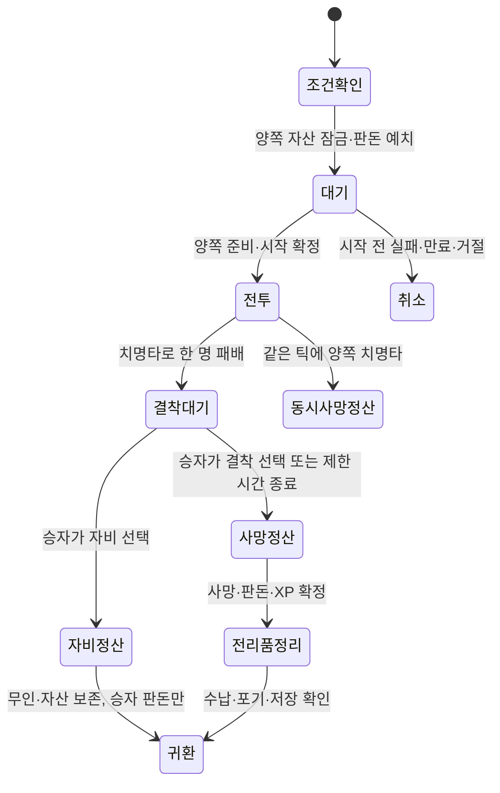

# 비무·생사결·시즌 설계

2026-09-30. [상위 설계](../next-stage-design.md)의 추천 초안이다. 비무 무보상/시즌 보상, 생사결 실물 손실/자비는 사용자 확정이다. 첫 1대1, 경기 보정 방식, 시간·판돈·자비 기본값·시즌 수치는 아직 확정하지 않았다.

## 두 모드의 차이

| 항목 | 비무 | 생사결 |
| --- | --- | --- |
| 목적 | 랭킹·숙련 경쟁 | 좋은 무인과 자산을 건 위험한 대결 |
| 출전 | 등록된 살아 있는 무인 | 등록된 살아 있는 무인, 실제 남은 HP와 자산 |
| 경기 능력 | 실제 무공·장비 추천, D1 답변에 따라 변경 | 실제 무공·장비 |
| HP | 경기용 HP, 실제 HP는 보존 | 실제 HP로 시작하고 결과를 유지 |
| 패배 | 경기 패배, 실제 사망 없음 | 치명타 후 자비/결착 절차에 따라 생존 또는 실제 사망 |
| 매 경기 보상 | 순위 점수만, XP·물품·재화 없음 | 결착 시 승자 XP·판돈·회수한 전리품, 자비 시 판돈만 |
| 소모품·장비 교체 | 전투 중 불가 | 전투 중 불가 |
| 가방·설정·설명 | 방 전체는 멈추지 않음 | 방 전체는 멈추지 않음 |
| 시즌 | 종료 시 계정 순위 보상 | 첫 버전은 별도 순위·시즌 경제 보상 없음 |

## 비무의 첫 경기 추천

1대1·3판 2선승·라운드 90초를 시작안으로 둔다. 매 라운드 경기 HP는 해당 출전 스탯의 최대치, 궁극 게이지 0, 방어/기본 공격 쿨타임 0에서 시작한다. 실제 세가 무인의 HP·무공 성장·물품은 결과로 변하지 않는다. 무공의 해금 단계와 피해·이동·방어 성능은 실제 빌드를 사용한다.

라운드 종료는 경기 HP 0, 항복, 시간 제한이다. 시간 제한은 남은 HP 비율이 높은 사람이 이기고 같으면 무승부다. 한 라운드의 동시 0HP도 무승부다. 무승부를 포함해 최대 5라운드 또는 전체 8분에서 종료하며 승리 라운드 수가 같으면 경기 무승부로 정산한다. 무한 연장이나 갑자기 높은 지속 피해로 한쪽 무공을 유리하게 만들지 않는다.

- 출전 구성은 매칭 확정 때 잠근다. 라운드 사이의 무공 목록·연결 검·착용품 교체는 없다. 경기 안 Q/E 전환은 가능하다.
- 시작 전 양쪽 자료와 연결 준비를 확인하고 3초 카운트다운을 준다. 카운트다운 동안 공격·피해는 없다.
- 경기 종료 시 결과 한 번, 순위 갱신 한 번, 실제 무인 상태 보존을 확인한다.
- 비무를 이용해 실제 HP나 방어 재사용 상태를 무료 회복하지 않는다. 경기용 값과 로비의 영속 값을 별도 저장한다.
- 무공별 게이지를 전환으로 초기화하거나 새 게이지를 받지 않는다. 같은 방어를 연속 전환해 공통 행동 제한을 우회하지 못한다.

### 매칭과 순위

순위는 무인이 아니라 세가 계정에 귀속한다. 무인이 사망하거나 새로 태어났다고 숙련 순위가 초기화되면 초보자를 계속 만나는 문제가 생긴다.

추천 검색 기준은 지역/지연 → 경기 가능 상태 → 전력 범위 → 세가 MMR 순이다. 전력은 캐릭터 레벨만 보지 않고 실제 선택한 무공 단계·해금 행동·장비 성능을 함께 평가한다. 무공의 공격력·범위·방어·흡혈을 한 숫자로 완벽히 비교할 수 있다고 가정하지 않고 실제 승률과 매칭 실패를 함께 측정한다.

- 먼저 비슷한 전력과 MMR을 찾고 30초 단위로 MMR 허용 범위를 완만히 넓힌다. 큰 전력 격차를 자동으로 허용하지 않는다.
- 인원이 적으면 긴 대기/취소를 안내한다. 랭킹 봇을 실제 플레이어처럼 넣거나 몰래 전력을 보정하지 않는다.
- 테스트용 비랭크 방은 다른 계정 없이 확인할 수 있으나 MMR·보상을 주지 않는다. 첫 공개 메뉴에는 기능이 준비된 것만 노출한다.
- 양쪽 동의 전 상대 세부 빌드를 공개하지 않고, 확정 후 공개한다. 큐 도중 장비·무공·수명 조건이 바뀌면 큐를 취소하고 다시 검사한다.
- 첫 MMR은 1000, 기본 변화 상한 24점, 신규 배치 10경기를 조정값으로 둔다. 승률 예상은 Elo 기본식으로 시작하되 첫 시즌의 분포를 보고 조정한다. 점수를 얻기 위해 새로운 캐릭터를 반복 생성해도 계정 MMR을 재설정하지 않는다.
- 재접속·결과 재요청·두 탭으로 동일 경기 점수를 두 번 지급하지 않는다. `matchId+accountId` 정산 키를 고유하게 둔다.

D1을 표준화 방식으로 선택하면 경기 스탯 생성 정책만 교체한다. 예를 들어 보유 무공을 같은 해금 단계로 바꾸는지, 장비만 중립화하는지도 구현 전에 정해야 한다. 두 방식을 무작위로 섞어 같은 랭킹으로 운영하지 않는다.

## 비무 시즌

시즌 4주·한국/세계 시간대 표시·최소 10경기 참가를 시작안으로 둔다. 결과 화면과 기록에서 현재 순위·등급·종료 시점만 간단히 보여준다.

시즌 경계는 서버 UTC이며 그 시각 이전에 시작한 경기는 해당 시즌으로 정산한다. 시즌 종료 후 짧은 정산 유예를 두고 진행 중인 경기가 끝난 뒤 최종 순위를 확정한다. 종료 직전 참가 자격·빌드 잠금·계정 상태를 다시 검사한다. 최종 시각과 보상 대상은 결과 원장에서 재현할 수 있어야 한다.

보상 추천은 세가 칭호·문양·외형이며 계정에 남긴다. 보상이 전투 자산이길 원하면 별도 보상표를 정한다. 어느 경우든 경기별 보급품·비급·재화·일일 참여 선물을 주지 않는다. 순위 동률은 MMR, 해당 시즌 유효 승리 수, 먼저 해당 점수에 도달한 시각 순의 결정 규칙을 표시한다.

보상은 `seasonId+accountId+rewardTier` 고유 키로 한 번만 지급한다. 운영 조사 중 계정은 확정 목록에서 보류하고 결과와 사유를 기록한다. 계정 영구 전투 스탯을 시즌 보상으로 올리는 방식은 첫안에 포함하지 않는다.

## 생사결 입장과 결착

첫 생사결은 같은 지역의 1대1·양쪽 합의 판돈·1판으로 추천한다. 현재 모델에 없는 세가 지갑은 서버 원장으로 추가한다. 판돈은 두 세가가 각각 같은 금액을 에스크로에 맡기며, 동의한 금액보다 많은 재화나 창고 장비가 추가로 걸리지 않는다.

입장 직전 `실제 사망 시 무인과 착용품·가방 손실`, 남은 HP·수명, 판돈 총액을 같은 화면에서 확인한다. 생사결은 강호 진행 중이거나 이미 다른 방에 출전한 무인으로 참가할 수 없다. 연결·자료 로딩·동의가 끝나기 전에 판돈을 소비하거나 캐릭터를 피해 상태로 만들지 않는다.

### 자비 추천안 — 특히 검토할 정책

치명타는 먼저 `defeated` 상태로 전환한다. 이 상태는 아직 사망 정산 전이며 움직임·공격이 없고 양쪽 전투도 종료한다. 승자에게 **8초 동안 `자비를 베풀기` / `결착짓기`**를 제공한다. 기본 만료 결과는 원래 생사결처럼 결착·사망으로 추천한다. 선택하지 않아도 살려주는 방식이 좋다면 기본값만 바꾸되 입장 설명도 바꿔야 한다.

- 자비: 패자 HP를 1로 남기는 추천안, 승자 현재 HP는 유지, 양쪽 물품 소유권 보존, 승자는 판돈 총액만 획득. XP·현상금·장비 보상은 없다.
- 결착: 패자 사망을 원자적으로 확정하고 착용·무장·일반 가방의 물품을 현장으로 옮긴다. 승자에게 판돈과 제한된 캐릭터 XP를 지급하고 직접 수납하게 한다.
- 승자가 창을 닫거나 연결이 끊겨도 서버의 결정 마감 시각은 유지한다. 마지막 요청과 시간 만료가 경합하면 하나의 최종 결과만 확정한다.
- 패자는 결착 화면에서 상대 장비를 가져오거나 스스로 무료 귀환할 수 없다. 상태와 결정 마감만 확인한다.
- 전리품은 가방에 들어간 것만 가져간다. 남은 물품 포기와 종료는 목록·수량 확인을 거친다. 버튼 한 번으로 초과분까지 창고로 자동 지급하지 않는다.

자비 시간과 자동 사망은 새 제안이며 승인 전 온라인 실물 모드에 적용하지 않는다. 초대·입장·결착 화면의 의미가 일관되게 설명되어야 한다.

### 특수 결과 추천

| 상황 | 결과 |
| --- | --- |
| 전투 제한 3분 | 서로 실제 HP를 유지하고 무승부, 양쪽 판돈 원금 반환, XP·전리품 없음 |
| 항복 | 일방 안전 귀환 버튼 대신 패배→같은 자비/결착 절차, 위험을 입장 전 명시 |
| 같은 틱의 양쪽 치명타 | 양쪽 실제 사망, 승자·XP 없음, 판돈 원금은 각 세가로 반환, 유품 회수자는 없으므로 손실 |
| 서버가 시작 확정 전 취소 | 자산 잠금 해제·판돈 원금 전액 반환 |
| 실제 수명 만료 | 서버 수명 규칙으로 사망·자산 회수, 경기 중 만료 정산은 별도 원인으로 처리, 상대의 전투 처치로 위장하지 않음 |
| 지급/정산 저장 실패 | 결과 확정 대기, 물품 이동·재출전 차단, 같은 키로 재시도 |

동시 사망·수명 만료·시간 제한의 정책은 위험 모드 공개 전 확정할 항목이다. 동시 타격을 배열 순서로 처리해 무조건 한 쪽만 살리는 판정을 피한다.

## 연결 해제와 부정행위

전투는 클라이언트 창을 닫아도 멈추지 않는다. 추천 재접속 유예는 30초이며 마지막 입력을 계속 반복하지 않는다. 입력이 200ms 이상 새로 오지 않으면 이동·공격을 중립 상태로 바꾸고 캐릭터는 현장에 남긴다.

- 비무: 30초 동안 돌아오지 않으면 패배, 실제 무인은 보존. 상대도 단절됐거나 서버 장애면 경기 무효 판정을 별도 원인으로 남긴다.
- 생사결: 유예 중에도 상대가 공격할 수 있다. 유예 종료는 패배→같은 자비/결착으로 처리한다. 접속 종료 자체로 전리품을 창고에 되돌리지 않는다.
- 재접속 토큰은 계정·방·만료와 묶고 기존 연결을 교체한다. 재접속 전에 이미 사망 확정이면 관전/결과만 복구한다.
- 동일 상대 반복 처치는 생사결 XP의 증가 경로가 되지 않게 계정 쌍별 24시간 XP 예산을 두고 초과 시 지급하지 않는다. 경제/위험 결과는 입장 동의대로 처리한다. IP만으로 부정행위를 확정하지 않는다.
- 정산·아이템·피해는 서버가 판정한다. 클라이언트가 `victory`·`damage`·`item owner`를 전송해서 결과를 만들 수 없다.
- 전투에서 인위적인 지연 시간을 넣어 체감 입력을 늦추지 않는다. 내 이동·공격 준비는 예측할 수 있지만 적중·피해·반격 성공은 서버 확정 후 표현한다.

매칭 범위·입력 시한·재접속 유예는 첫 네트워크 실험의 조정값이다. 숫자를 문서에 적었다고 악용 방지·공정성이 검증된 것은 아니다.

## 화면과 판정 완료 기준

- 비무 승/패/무승부/재접속 30초 실패/서버 무효 모두 실제 HP·무공·물품이 전과 같은지 확인한다.
- 생사결 자비·사망·시간 제한·동시 사망·판돈 중복 요청·결착 마감 경합·승자 단절을 검사한다.
- 레이드와 PVP가 같은 세가·무인·장비를 동시에 잠글 수 없고, 시장 매물과 출전 장비가 겹치지 않아야 한다.
- 양쪽 플레이어에서 전조·피격·반격·궁극·Q/E·가방 열린 동안 시간 진행을 지연·손실 환경에서 확인한다.
- 라운드 시작/종료에 남은 눌림 입력을 비우며, 재접속이 지난 공격을 한꺼번에 재생하지 않게 한다.
- 짧은 HUD에 경기 점수·남은 시간·상대 체력, 결착 화면에는 실제 손실·판돈·자비를 표시한다. 가방과 결과는 현재 한눈에 보는 배치를 재사용한다.
- 4주 시즌을 테스트 시계로 넘겨 참가·마감·경기 정산·보상 지급·중복 지급 방지를 검사한다. 실제 계정 시각이나 저장을 바꾸지 않는다.
