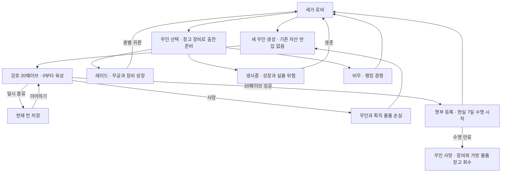

# 무공 — 1차 게임 기획

작성일: 2026-09-27

2026-09-28 개발 계획 추가 확정: 브라우저 우선·이후 모바일 앱, PC 조작과 기기 내 저장으로 강호 한 사이클을 먼저 구현한다. 시작과 성장 규칙은 아래 수정과 [최신 개발 기준](implementation-v1.md)을 따른다.

이번 대화에서 확인한 규칙을 통합한 새 개발의 기준이다. 이전 코드·런타임 에셋·기술 스택은 계승하지 않는다. 원대화의 세계관·무공·아이템 소재는 참고하며 현재 사용자 답변이 우선한다. 상세한 결정 기록과 이미지 기준은 [사용자 확인 기획 방향](design-direction.md)에 있다.

## 1. 게임의 중심

세가를 운영하며 강호에서 새 무인을 만들어, 그 무인으로 레이드와 생사결에 도전하고 비무의 순위를 겨룬다. 새 무인을 만드는 과정, 귀환한 무인에게 투자하는 과정, 그 무인과 자산을 위험에 거는 과정이 이어진다.

카툰풍 무협 화면 안에서 간결하고 빠른 탑뷰 수동 액션을 제공한다. 사용자가 승인한 검객 시안의 선명한 외곽선·간결한 셀 셰이딩·약 5등신 비례를 새 기준으로 삼는다. [새 디자인 기준](art-direction-cartoon-v1.md)을 따른다. 움직임·공격 방향·무기와 손의 연결·타격 판정은 실제 움직이는 화면으로 검증한다. 복잡한 RPG식 스킬바와 공용 마나는 도입하지 않는다.

## 2. 기본 흐름

20웨이브 완료는 캐릭터 생성 과정의 완료다. 이후 성장의 영구 고정점이 아니다. 같은 무인을 다시 강호 육성에 보내는 추가 파밍·엔드리스 모드는 이번 기본 흐름에 넣지 않는다.

## 3. 강호 — 새 캐릭터 생성

- 매번 새로 생성한 무인이 0부터 시작한다. 세가 창고의 장비나 기존 자산을 반입하지 않는다.
- 튜토리얼과 유사한 캐릭터 생성 과정이며 20웨이브 완료 전 귀환할 수 없다. 난이도·지역·사건이 매번 고정된다는 의미는 아니다.
- 기존 컨셉은 지역 후보 약 10개, 5웨이브씩 네 구간이다. 각 구간의 네 번째는 정비, 다섯 번째는 보스다. 첫 구현의 콘텐츠 개수는 별도로 좁힌다.
- 정비 중 가방 정리·소모품 사용·무장 변경이 가능하고, 해당 런의 재화로 이용하는 이벤트 상인·의원이 등장할 수 있다. 세가 창고 반입이나 조기 반출은 없다.
- 사망하면 생성 중인 무인과 획득 물품을 모두 잃는다. 다음 시도는 새 무인이다.
- 일시 종료하면 현재 런과 이미 발생한 결과를 저장해 이어간다. 사망 전으로 되돌리지 않는다.
- 20웨이브 성공 후 무인을 명부에 등록하고 로비로 돌아온다. 이 순간부터 현실 7일 수명이 시작된다.

## 4. 무공과 장비 성장

- 기본 입력은 WASD 이동, Q/E 무공 전환, 좌클릭 기본 공격, 우클릭 현재 무공의 궁극 행동이다. Space는 현재 무공별로 다른 회피·반격·회복·방어 행동이며 공통 회피가 아니다.
- 평소에는 이동 방향을 바라보고 공격 입력 시 클릭 방향으로 향한다.
- 무공 없이 캐릭터 Lv.0과 미숙한 기본 공격으로 시작한다. Lv.1부터 첫 무공을 선택하고, 이후 레벨마다 증강 카드처럼 새 무공 습득 또는 기존 무공 +1을 고른다. 최대 네 무공을 갖고 네 개를 채우면 새로운 무공이 등장하지 않는다. 기존 무공을 버리고 교체하지 않는다.
- 일반 무공은 Lv.5, 삼재검법은 Lv.10이 상한이다. 보통 무공의 기본 틀은 기본기 A → 패시브 → 기본기 B → 패시브 → 궁극기이며 B가 열린 뒤 A/B를 번갈아 사용한다.
- 삼재는 Lv.8에 일반 완성형 수준, Lv.9에 검기, Lv.10에 이기어검으로 변한다.
- 전투·비급·수련 아이템 경험치는 캐릭터 경험치로 통합한다. 무공은 캐릭터 레벨업 선택으로 성장하며, 독립적인 무공 경험치가 선택 기회를 우회하지 않는다. 강호 완료 때 Lv.13~16을 목표로 하여 일반 무공을 아무리 집중해도 최대 세 개 정도 완성하는 투자량으로 맞춘다. 귀환 이후에도 캐릭터 레벨과 무공·장비 성장을 이어간다. 비무에는 경험치·성장 보상이 없다.
- 공통 마나는 없다. 무공별 궁극 행동을 위한 게이지를 사용하며 개방의 취기 같은 개별 규칙을 구분한다. 첫 구현은 무공별 게이지·A/B 순서·방어 재사용 시간을 전환 후 유지한다.

## 5. 레이드 — 파티와 유품

솔로 또는 플레이어 2~4명이 각자 무인 한 명을 조작하는 5층 구조다. 로비에서 창고 장비를 자유롭게 준비해 출전한다.

- 아군 공격 피해는 없다.
- 적·보스의 일반 전리품은 플레이어별로 드랍하고 각자 획득한다.
- 층을 클리어하면 각자 귀환하거나 다음 층에 도전한다.
- 이탈자가 발생하면 다음 층 진입 전 남은 인원도 다시 귀환을 선택할 수 있다. 변경된 인원을 보고 선택한다.
- 다음 층 난이도는 최종적으로 남은 인원에 맞춘다. 정비 후 남은 인원 전원이 준비하면 진입한다. 제한 시간 때문에 자동 진입시키지 않는다.
- 층 사이에 가방 정리·소모품 사용·연결 무기 및 착용 장비 변경이 가능하다.

사망하면 무인은 사망하고 착용 장비·가방 물품이 현장에 떨어진다. 아군이 가방 공간을 써서 유품을 챙길 수 있다. 유품 소유권은 원래 세가에 남고, 회수자가 자기 장비로 사용하거나 판매·거래할 수 없다. 회수자가 생환하면 원래 세가의 창고로 자동 반환한다. 사망한 무인은 돌아오지 않는다.

## 6. 비무와 생사결

| 모드 | 목적·보상 | 패배·사망·자비 |
|---|---|---|
| 비무 | 랭킹 경쟁. 경험치·아이템·재화 등 다른 이점 없음. 시즌 종료 시 순위 보상 | 안전한 대결을 기본으로 하며 실제 체력 처리 등 세부 판정은 후속 설계 |
| 생사결 | 무인·실물 자산을 걸고 경쟁. 성장과 전리품, 판돈·현상금 컨셉 | 사망한 패자는 착용 장비·가방 물품을 모두 드랍하고 승자가 챙길 수 있음 |
| 생사결의 자비 | 치명타 직전 상대를 살리는 선택 | 상대의 무인·장비·물품은 보존, 승자는 판돈만 획득 |

세가 창고에 두고 출전하지 않은 자산은 전투 사망의 현장 드랍 대상이 아니다.

## 7. 수명과 체력

- 무인의 현실 7일 수명은 강호 성공·명부 등록 때 시작한다. 현실 시간이므로 게임 화면의 일시 정지와 구분한다.
- 반로환의 반복 복용 효율은 감소한다. 강한 무인을 오래 유지하려면 계속 비용을 지불하는 방향이며 정확한 감소표는 아직 확정하지 않았다.
- 수명 만료 시 무인은 사망하고 착용 장비·가방 물품은 창고로 자동 회수한다. 전투 사망과 다르다.
- 위험 콘텐츠 사이 자동 체력 회복은 없다. 생존 당시의 남은 체력이 다음 출전에 영향을 준다. 회복약·정비·의원 등 비전투 회복 수단을 사용한다.

## 8. 가방, 정리판, 창고와 시장

무장 가방과 일반 가방은 모두 테트리스 수납이다. 무장 가방의 무기만 무공에 연결할 수 있다. 일반 가방에도 무기를 넣을 수 있지만 그 상태로는 무공에 연결할 수 없다. 가방 안 중첩과 자동 정렬은 없다. 칸 수와 물품 크기는 실제 수납 플레이로 조정한다.

임시 정리판은 가방 아래에 물품을 펼치는 작업 공간이며 실제 월드의 바닥이 아니다. 소모품·재료는 중첩하고 장비는 개별 표시한다. 물품을 남기고 가방을 닫을 때 목록·수량을 보여준 뒤 폐기를 확인한다. 취소하면 정리를 계속한다.

세가 창고는 단순 슬롯·중첩 보관을 사용한다. 장비는 개별 보관한다. 시장은 로비의 관리 기능이며, 품질이 다른 장비는 개별 매물, 표준 소모품·재료는 호가 거래를 기본으로 한다. 무인 거래는 금지하고 거래 수수료를 둔다. 장비의 능력치를 바로 공개한다.

## 9. 화면 구조와 허용 행동

| 상황 | 상단 로비 메뉴 | 가방이 열린 동안 | 가방·정리판 행동 |
|---|---|---|---|
| 세가 로비 | 있음: 명부·가방·창고·시장 등 | 비전투 | 정리·소모품·무장 변경 가능 |
| 강호 전투 | 없음 | 전투 일시 정지, 캐릭터 조작 불가 | 정보 확인만 |
| 레이드·PVP 전투 | 없음 | 전투 계속, 캐릭터 조작 불가 | 정보 확인만 |
| 강호 정비 | 없음. 정비의 지역 행동만 제공 | 시간제한 없는 비전투 | 정리·소모품·무장 변경, 이벤트 상인·의원 |
| 레이드 층 사이 | 없음. 파티 귀환·준비 기능 제공 | 비전투 정비 | 정리·소모품·무장 변경 |

로비는 선택한 무인과 명부를 중심으로 출전·가방·창고·시장으로 이어진다. 전투는 위쪽의 상태·보스·진행 정보, 중앙 전투 공간, 아래쪽의 현재 무공·전환·궁극 게이지를 기본으로 한다. 가방은 왼쪽 무인·무공, 중앙의 분리된 두 가방, 오른쪽 아이템 정보, 아래쪽 임시 정리판으로 배치한다. 장비 시장은 왼쪽 필터, 중앙 개별 매물, 오른쪽 상세·구매로 배치한다.

사용자는 두 번째 카툰풍 줌아웃 시안의 맵·캐릭터 축척을 승인하고 UI는 [앞서 정리한 와이어프레임](wireframes/mugong-first-draft.html)으로 유지한다고 확인했다. 새 이미지의 임시 체력바·원형 아이콘은 채택하지 않는다. 기존 UI 배치·기능·디자인을 승인한 넓은 맵 위에 적용한다.

## 10. 제작 순서와 후속 세부 사항

전투 카메라는 캐릭터를 작게 표시하고 이동·회피할 공간을 넓게 보여준다. 한 맵은 아이작의 일반 방보다 약 두 배 넓게 느껴지는 방향이며, 정확한 월드 면적과 표시 축척은 실행 검증으로 맞춘다. 카툰풍 첫 전투 시안의 큰 캐릭터 크기를 기준으로 사용하지 않는다.

첫 검토 대상은 로비, 가방, 장비 시장, 강호 전투·정비, 레이드 전투·층 사이의 화면 구조다. 화면 예시의 인물 이름·체력·시간·가격·격자 크기는 확정 밸런스가 아니다.

다음 구현 검증은 한 캐릭터의 걷기·공격·무공 전환·판정이 이어지는 짧은 실제 플레이 구간이다. 해당 결과를 기준으로 엔진·스택·애니메이션 방식의 적합성을 판단한다. 기존 구현의 코드·에셋을 반입하지 않는다.

아래 세부 항목은 화면 구조를 검토한 뒤 정하며 새 질문 묶음을 자동으로 늘리지 않는다.

- 첫 무공·기본 무장의 지급 방식, 실제 경험치·드랍·품질·가격·수수료와 반로환 수치.
- 연결 끊김·저장 판정, 전투 중 수명 만료, 창고 초과 수령과 아군 유품의 재드랍·폐기 예외.
- 파티 준비 대기의 운영, 아군 충돌, 비무의 실제 체력 처리, 자비·생사결 경험치 지급 타이밍.
- 월드에서 줍는 행동과 가방의 읽기 전용 상태 연결, 임시 정리판의 화면 전환 시 유지 범위.
- 신규 비급이 시장에 있을 때 네 무공을 가진 무인의 구매·사용 조건과 세계 유일품·과금 같은 후순위 정책.
