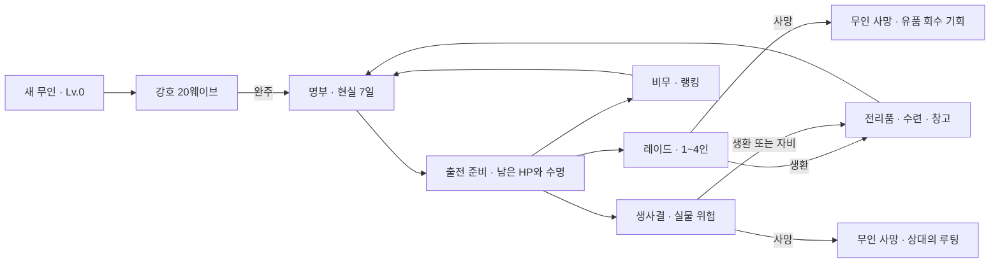

# 다음 개발 단계 설계 — 보스·레이드·PVP

2026-09-30. 현재 코드와 사용자 확정 기획을 대조한 **검토용 설계안**이다. 이번 작업은 설계이며 런타임·사용자 저장·공개 배포를 변경하지 않는다. 기존 확정 규칙은 유지하고, 새 콘텐츠명·수치·정산 예외는 아래의 추천안으로 구분한다.

## 설계 문서

| 문서 | 담은 내용 |
| --- | --- |
| [보스와 레이드](design/bosses-raids-v2.md) | 강호 네 보스, 첫 5층 레이드, 패턴·전조·난이도·파티 귀환·유품 |
| [비무와 생사결](design/pvp-v2.md) | 전투 규칙, 매칭, 자비, 판돈, 랭킹·시즌, 이탈·동시 사망 |
| [온라인과 영속 상태](design/online-progression-v2.md) | 서버·계정·저장·소유권·성장·경제·수명·연결 복구·운영 |
| [화면과 제작 순서](design/next-stage-delivery-v2.md) | 실제 화면 동선, 에셋·텍스트·사운드, 구현 의존성·완료 기준 |

## 현재 구현과 다음 범위

현재 확인한 실제 코드는 `src/domain/model.ts`, `game.ts`, `combat.ts`, `content.ts`, `src/platform/store.ts`, `deploy/nginx.conf`다. 기존 기획의 아직 없는 기능을 구현된 것으로 계산하지 않는다.

| 영역 | 현재 | 다음 설계 |
| --- | --- | --- |
| 강호 | Lv.0 시작, 20웨이브·네 정비·네 보스전 | 네 구간의 보스 개성과 전투 학습 흐름 |
| 보스 | `chief`·`captain` 두 계열, 후반 돌진·방사 발사 | 패턴을 데이터로 분리하고 보스별 조합·페이즈 제공 |
| 전투 | `Run.fighter` 한 명, 적·탄·공격·효과 | 여러 전투 주체와 진영, 서버 판정 및 모드별 종료 |
| 귀환 이후 | 명부·창고·수련·수명 | 레이드 출전, 온라인 성장·유품, 비무·생사결 |
| 자산 | 브라우저 IndexedDB에 세가와 런 | 계정 소유권, 출전 잠금, 중복 없는 결과 정산 |
| 배포 | Daytona Nginx 정적 플레이 미리보기 | API·실시간 방·DB·복구·모니터링을 갖춘 온라인 검증 환경 |

## 바꾸지 않는 규칙

출처는 [게임 기획](game-design-v1.md), [개발 기준](implementation-v1.md), 이후 사용자 지시다.

1. 강호는 새 무인을 만드는 20웨이브 과정이다. Lv.0·무공 없음에서 시작하고 창고 자산을 반입하지 않는다. 완료 전 귀환은 없으며 일시 종료는 같은 런을 이어간다.
2. 성공한 무인의 HP·무공·장비를 보존하고 이때 현실 7일 수명이 시작된다. 다음 성장은 레이드와 생사결에서 이어진다. 비무는 경기 성장 보상이 없다.
3. 경험치는 캐릭터에 통합한다. 레벨마다 새 무공 또는 기존 무공 +1을 선택한다. 네 개를 채우면 신규 후보가 나오지 않는다. 일반 Lv.5·삼재 Lv.10 상한을 유지한다.
4. 소모품·장비 변경·가방 정리는 비전투에서만 가능하다. 전투 가방은 정보용이다. 강호만 가방·성장·일시 정지로 전투를 멈추며 온라인 레이드·PVP는 계속된다.
5. 무장 4×7·일반 10×8, 무장 가방의 검만 무공에 연결한다. 무공별 게이지·공격 순서·Space 행동과 재사용 시간은 전환 후에도 유지한다.
6. 레이드는 솔로 또는 2~4인·5층이다. 아군 피해가 없고 일반 드랍은 개인별이다. 층마다 개인 귀환을 선택하며 이탈 발생 후 남은 사람도 다시 선택한다. 최종 인원 전원이 준비해야 다음 층에 진입한다.
7. 레이드 사망 시 실제 무인·착용 장비·가방 물품이 유품으로 남는다. 회수자는 공간을 써서 운반하지만 소유권은 원래 세가에 있고 사용·판매할 수 없다. 생환하면 원래 세가로 자동 반환한다.
8. 생사결 사망 시 패자의 착용품·가방이 떨어져 승자가 챙긴다. 자비를 베풀면 상대 무인·자산을 보존하고 승자는 판돈만 받는다. 창고 자산은 전투 드랍에서 제외한다.
9. 수명 만료는 전투 사망과 구분해 물품을 창고로 회수한다. 위험 콘텐츠 사이 자동 HP 회복은 없다.
10. 카툰 캐릭터·넓은 전체 맵, 종이·먹·금속의 무협 UI, 짧고 경쾌한 과장 효과음을 유지한다. 전투 하단은 부채 무공/QE·중앙 궁극·우측 방어다.

## 다음 플레이의 완성 모습

비무는 숙련도를 겨루는 안전한 경쟁, 레이드는 공략과 수납·귀환의 판단, 생사결은 좋은 무인을 위험에 거는 결투로 차이를 만든다. 메뉴 이름만 다르고 같은 보상을 주는 모드로 만들지 않는다.

## 첫 출시 콘텐츠 추천 범위

| 대상 | 첫 목표 | 다음 확장 |
| --- | --- | --- |
| 강호 | 현재 네 구간·네 보스의 패턴과 실루엣 완성 | 지역·사건·새 무공 다양화 |
| 레이드 | `흑풍산채` 가칭 한 곳·5층, 공용 적 3종·새 보스 2종 | 다른 레이드 테마·전용 보상 |
| 비무 | 1대1, 같은 지역·비슷한 전력과 순위, 한 경기 결과 | 팀전·관전·대회 |
| 생사결 | 1대1·합의 판돈·자비·회수·정산 | 현상금·별도 위험 지역 |
| 장비 | 기존 7종류, 장비 정의와 품질의 분리·검증 | 새 무기 계열·장비 고유 효과 |
| 경제 | 서버 지갑·레이드 수입·비전투 보급, 기본 장비 시장 | 표준품 호가·추가 세가 기능 |
| 계정 | 온라인 세가·명부·창고·기록·계정 복구 | 친구·길드·모바일 |

예전 자료에 있는 40보스·다수 지역·히든 무공 목록을 첫 출시 분량으로 가져오지 않는다. 먼저 한 레이드의 입장→공략→성장→귀환/사망→정산을 완성한다.

## 검토가 필요한 세 가지 큰 선택

아래는 묶음 질문으로 전달했다. 답변 전에는 추천 기준으로 설계를 전개하되 **사용자 확정으로 기록하지 않는다**.

| ID | 추천 기준 | 다른 방향을 고르면 달라지는 것 |
| --- | --- | --- |
| D1 | 비무는 실제 무공·장비를 사용하고 전력과 랭킹을 함께 고려해 매칭 | 표준화 방식이면 경기 전용 스탯 생성·순위 해석·세가 투자 가치가 바뀐다 |
| D2 | 비무·생사결 모두 1대1부터 | 2대2 동시 출시라면 팀 순위·파티 매칭·동시 사망·관전이 첫 범위로 들어온다 |
| D3 | 읽기 쉬운 전조·회피·반격, 후반 조합 강화 | 탄막 중심 또는 빠른 반응 중심이면 맵·패턴·회복 공급·연출 기준부터 달라진다 |

다른 세부 수치와 예외도 각 문서에 추천값으로 표시한다. 매칭·자비 기본값·시즌 보상·연결 해제·수명 만료의 정책은 온라인 위험 모드를 켜기 전에 결정 기록에 확정해야 한다. 기획 문서를 썼다는 이유로 실물 손실 정책을 바로 서비스에 적용하지 않는다.

## 권장 개발 순서

**보스 공통 구조와 강호 네 보스 → 솔로 레이드 1층의 전체 왕복 → 계정·서버 판정·자산 정산 → 2~4인과 5층 → 비무 → 생사결 → 시즌·시장 확장** 순서다.

솔로 레이드 1층은 공략·성장·수납·귀환을 확인하는 로컬 검증 단계다. 온라인 자산은 온라인 강호에서 생성하며 로컬 저장을 온라인 계정 자산으로 승격하지 않는다. 서버 판정과 영속 정산이 끝나기 전에 온라인 생사결을 공개하지 않는다.

단계별 개발 항목, 의존성과 완료 기준은 [제작 순서](design/next-stage-delivery-v2.md)에 둔다. 날짜와 서비스 동접은 실제 구현·측정 전 확약하지 않는다.

## 설계에서 발견한 우선 해결점

- 현재 `friendly: boolean`, `Run.fighter`, 전투 중 성장에 따른 전체 정지는 여러 사람의 공략·결투를 표현하지 못한다. 공통 전투 상태에 전투 주체와 진영을 도입하고 강호의 기존 흐름을 어댑터로 유지한다.
- 레이드에서는 캐릭터가 성장해도 다른 사람을 멈출 수 없다. 전투 경험치의 성장 선택은 층 클리어 정비에서 처리하는 추천안으로 분리한다.
- 체력·사망·전리품·유품·판돈·시장·수명은 같은 서버 소유권/결과 원장을 사용해야 한다. 모드별로 자산 복사본을 따로 저장하면 중복 수령과 부활이 생긴다.
- 기존 로컬 저장은 보존한다. 온라인은 별도 세가·저장 공간·확정 상태를 사용한다. 마이그레이션 실패나 접속 실패로 기존 저장을 초기화하지 않는다.
- 7일 수명과 무제한 레이드 정비가 만나면 세션 중 만료가 발생할 수 있다. 서버 시각과 만료·전투 사망의 우선순위를 명시한다.

## 기술 확인의 출처

실시간 방·동기화·매칭은 [Colyseus 공식 문서](https://docs.colyseus.io/)를 근거로 도입 후보를 선정했다. 프로젝트에서 서버 판정과 PostgreSQL 원장을 결합하는 구조는 이 설계의 선택이다. 자동 재접속이 게임의 정산·사망 복구까지 해결한다고 가정하지 않는다. [온라인 상세 설계](design/online-progression-v2.md)에 공식 재접속·DB 잠금·WebSocket 문서를 함께 기록했다.

이번 검토는 소스·기획·공식 문서와 상태 전환의 정합성 검토다. 신규 보스의 재미·PVP 밸런스·서버 성능을 플레이나 부하 테스트로 검증한 결과는 아니다.
